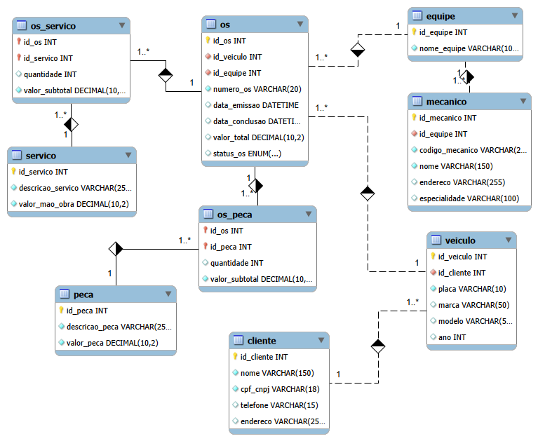

# ⚙️ Desafio de Modelagem de Banco de Dados: Oficina Mecânica

Este repositório contém a resolução do desafio de construção de um esquema conceitual (e lógico) para o contexto de uma Oficina Mecânica, do zero. O objetivo foi criar o diagrama Entidade-Relacionamento com base nas necessidades de gestão de Ordens de Serviço (OS), clientes, mecânicos e tabelas de referência de peças/mão-de-obra.

## 📌 Premissas e Regras de Negócio Assumidas

A partir da narrativa fornecida, as seguintes decisões de modelagem foram tomadas para preencher as lacunas operacionais:

1. **Atribuição da Equipe (Mecânicos):**
   - Embora a narrativa refira que "cada veículo é designado a uma equipe", na prática de banco de dados, é a **Ordem de Serviço (OS)** que é designada à equipe. Um cliente pode regressar à oficina meses depois e ser atendido por uma equipe diferente. Logo, a relação de chave estrangeira (`id_equipe`) foi alocada na tabela `OS`.

2. **Fluxo de Aprovação do Cliente:**
   - A autorização da execução dos serviços pelo cliente foi modelada através do atributo `status_os` na tabela `OS`. Este campo ENUM transita entre os estados: `'Orçamento'`, `'Aguardando_Aprovacao'`, `'Aprovada'`, `'Em_Andamento'`, `'Concluida'` e `'Cancelada'`.

3. **Valoração da Ordem de Serviço:**
   - O `valor_total` da OS é derivado da soma dos serviços e peças aplicadas. Para isso, criaram-se tabelas intermediárias (`OS_Servico` e `OS_Peca`) que contêm um `valor_subtotal`, garantindo a integridade do histórico financeiro caso os valores base sofram alterações de preço no futuro.

## 🛠️ Estrutura do Repositório

* **`diagrama-oficina.png`**: Visualização do Diagrama Entidade-Relacionamento (EER).

* **`oficina_script.sql`**: Script DDL contendo a criação do banco de dados, tabelas, atributos e constraints (PKs e FKs).

* **`inserts_oficina.sql`**: Script DML com dados fictícios para popular a base e validar os relacionamentos.

* **`queries_oficina.sql`**: Consultas analíticas (DQL) para gestão de faturamento, frotas e detalhamento de OS.

## 🗄️ Diagrama Entidade-Relacionamento

